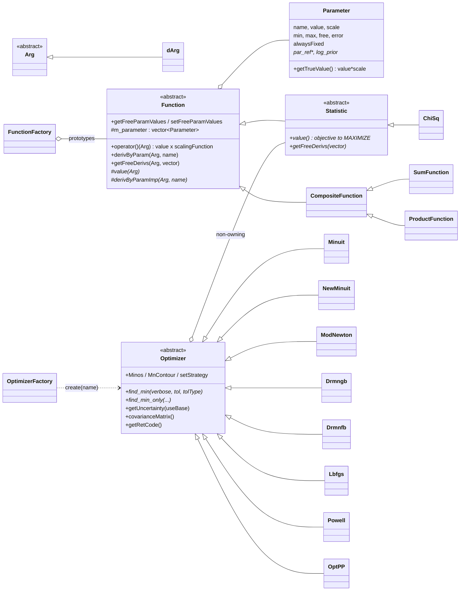

# optimizers Architecture

**optimizers** has two jobs:

1. It defines the **model vocabulary** used by every fit in the Fermitools:
   `Function` (a parameterized function of an `Arg`), `Parameter` (value,
   scale, bounds, free flag, error, prior) and `Statistic` (an objective
   function with no argument). Every spectral model, spatial model and
   likelihood in `Likelihood` is built on these classes.
2. It wraps several **minimizers** behind one `Optimizer` interface,
   chosen by name through `OptimizerFactory`. These are the names users
   pass as `optimizer=` to `gtlike` and pyLikelihood.

Most of the package's ~60,000 lines are not hand-written C++. About
31,000 lines are **f2c translations of Fortran** (`src/*_routines.c`,
`dgaus8.c`, `dpptri*.c`) and about 18,000 are the original Fortran sources
(`src/*.f`), which are kept for reference but not built. The hand-written
C++ is about 6,000 lines.

The Doxygen mainpage (`src/mainpage.h`) gives a correct but very brief
overview. It still refers to a `requirements` file (CMT) that no longer
exists. `doc/release.notes` stops in 2017. Use the code as the source of
truth.

## Purpose and scope

**Does:**
- Provide the `Function` / `Parameter` / `Arg` / `Statistic` abstractions,
  including parameter scaling, bounds, free/fixed flags, per-parameter log
  priors, and reading and writing parameters as XML `<parameter>` elements.
- Provide `Optimizer` subclasses that *maximize* a `Statistic` (by
  minimizing `-value()`), and estimate parameter uncertainties and
  covariance.
- Provide a prototype `FunctionFactory` that clones named `Function`
  prototypes and can load customized prototypes from a `function_library`
  XML file.
- Provide a few non-`Optimizer` tools: `Amoeba` (Nelder–Mead on a plain
  functor), `Mcmc` (Metropolis–Hastings sampler), `ChiSq`, and `FunctionTest`
  (a helper for checking derivatives of `Function` subclasses).

**Does not:**
- Define the Fermi spectral models. `Likelihood` defines its own
  `PowerLaw`, `LogParabola`, etc. and its own factory registrations. The
  `PowerLaw`, `BrokenPowerLaw`, `AbsEdge` and `ConstantValue` here are
  private (`src/`) and are used only by this package's `FunctionFactory`
  defaults and tests. `Gaussian` is public because `Likelihood`'s
  `AppHelpers` registers it.
- Compute likelihoods. `Likelihood::LogLike`, `BinnedLikelihood`,
  `SummedLikelihood` and the others are `Statistic` subclasses in
  `Likelihood`.
- Ship any applications or par files.

## Position in the system

| Direction | Package | Why |
|-----------|---------|-----|
| Depends on | `xmlBase` (PUBLIC) | RapidXML and the `xml_framework` helpers (`XmlDomBuilder`, `SafeXmlParser`, `XmlPrinter`). Used for `Parameter::extractDomData`/`createDomElement`, `Function::setParams(xml_node*)` and `FunctionFactory::readXml`/`writeXml`. `xml_node` appears in public headers, so the link is PUBLIC. |
| Depends on | `Minuit2` (`FermiMinuit2`, PUBLIC) | `NewMinuit` and `StMnMinos`. `NewMinuit.h` includes Minuit2 headers, so every consumer of that header needs Minuit2 include paths. |
| Depends on | f2c (PRIVATE, via the `optimizers_c_objects` OBJECT library) | Runtime support for the translated Fortran (old Minuit, DRMNGB/DRMNFB, L-BFGS-B, DPPTRI, DGAUS8). `optimizers/f2c_types.h` redefines the f2c types it needs so that public headers do not include `f2c.h`. |
| Depends on | cfitsio (PRIVATE) | Only `Mcmc::writeSamples`, which writes samples to a FITS binary table. |
| Depends on | CLHEP `RandomS` (PRIVATE) | Only `Mcmc` (`CLHEP::RandFlat`). |
| Test only | `st_facilities`, `facilities` | `test_optimizers` uses `st_facilities::Environment::xmlPath` and `facilities::commonUtilities::joinPath` to find `FunctionModels.xml`. |
| Used by | `Likelihood` | About 99 files. Every source, spectral and spatial model derives from `Function` and uses `Parameter`, `Arg`/`dArg`, `ParameterNotFound` and `Exception`. `SourceModel`, `SummedLikelihood`, `CompositeLikelihood`, `Composite2` and `OneSourceFunc` derive from `Statistic`. `OptimizerFactory` is used by `gtlike`, `gtfindsrc`, `gttsmap`, `gttscube`/`gthealcube` and `ScanUtils`/`FitScanner`. `Amoeba` is used by `gtfindsrc`. `Gaussian` is used in `AppHelpers`. `OptEM` uses `Lbfgs`, `Drmngb` and `Minuit` directly. `BinnedLikelihood` uses `Parameter::log_prior_value/deriv`. |
| Used by | `pyLikelihood` | The SWIG interface (`pyLikelihood.i`) wraps `Optimizer`, `OptimizerFactory`, `Parameter`, `Function`, `FunctionFactory`, `FunctionTest`, `Mcmc`, `Minuit`, `NewMinuit` and `Statistic` (`ParameterNotFound.h` is `#include`d but not wrapped). `AnalysisBase.py` drives `find_min`/`find_min_only`, `getUncertainty`, `covarianceMatrix` and `Minos`. It gets these through `Likelihood`; `pyLikelihood`'s CMake does not link optimizers directly. |
| Used by | `burstFit` | `BurstModel` derives from `Function`. `NegativeStat` derives from `Statistic`. `gtburstfit` uses `ChiSq` and `Minuit`. |
| Used by | `pyExposure` | `gtexposure` uses `Function`, `dArg` and `FunctionFactory`. |

**CMake vs. actual use:** `st_facilities` is linked PRIVATE into the
*library*, but no library source includes it; only `src/test/main.cxx`
does. By its real dependencies (`xmlBase`, `Minuit2` and externals),
optimizers belongs in the `foundation` tier, and that is where it is placed.
The unnecessary `st_facilities` link could be moved to the `test_optimizers`
target.

## Key abstractions



| Type | Header | Role |
|------|--------|------|
| `Arg`, `dArg` | `Arg.h`, `dArg.h` | `Arg` is an empty polymorphic base class, so that `Function::operator()` can take any argument type. `dArg` wraps a `double` (energy, for spectra). `Likelihood` adds `SkyDirArg`, etc. Subclasses `dynamic_cast` the `Arg` back to the concrete type. |
| `Parameter` | `Parameter.h` | Name, **scaled value**, `scale`, bounds, free flag, `alwaysFixed`, error, and two non-owning pointers: `m_par_ref` (forwards every setter to another `Parameter`; used by `Likelihood`'s `ScaleFactor`, `EblAtten` and `EnergyBand` decorators and by tied parameters) and `m_log_prior` (a `Function` giving the log prior). |
| `Function` | `Function.h` | Owns a `std::vector<Parameter>` and looks parameters up by name (linear search). `operator()` and `derivByParam` are non-virtual template methods. They call the protected virtuals `value(Arg)` and `derivByParamImp(Arg, name)`, then multiply by an optional owned `scalingFunction`. Also has `genericName` (type), `name` (instance), `normParName` (used by `normPar()`/`rescale()`), `argType` and `FuncType {None, Addend, Factor}`, which composites use. |
| `Statistic` | `Statistic.h` | A `Function` with `value()` and `getFreeDerivs(vector&)` that take no argument. This is the interface every `Optimizer` drives. **Convention: the optimizers maximize `value()`.** It is a log-likelihood, not −log L. |
| `CompositeFunction`, `SumFunction`, `ProductFunction` | public | Hold *clones* of two `Function`s and concatenate their parameter lists. Not used outside this package's tests (and `Likelihood/src/old_tests`). |
| `Optimizer` | `Optimizer.h` | Holds a non-owning `Statistic*`, `m_maxEval` (default `100 × getNumParams()`), a return code and a numeric-derivative flag. The base implements `getUncertainty` by a finite-difference Hessian, Cholesky decomposition and `dpptri_` inversion. `Minos`, `MnContour`, `setStrategy` and `minos_*_error` throw unless overridden. |
| `OptimizerFactory` | `OptimizerFactory.h` | Singleton. `create(name, stat)` returns a new `Optimizer` that the caller owns. |
| `FunctionFactory` | `FunctionFactory.h` | Name → owned prototype map. `create` clones a prototype. The constructor pre-registers `PowerLaw`, `BrokenPowerLaw`, `Gaussian`, `AbsEdge` and `ConstantValue`. `readXml` / `writeXml` handle `function_library` documents (`xml/FunctionModels.dtd`). |
| `Exception`, `OutOfBounds`, `ParameterNotFound` | public | `Exception` derives from `std::exception` and carries an integer `code()`. `OutOfBounds` (value or bounds error, with `value()`, `minValue()`, `maxValue()`) is thrown by `Parameter::setValue`/`setBounds`. Minimizers catch it to shorten steps. |
| `Amoeba`, `Functor` | `Amoeba.h`, `Functor.h` | Nelder–Mead (from Numerical Recipes) over a `Functor` with `double operator()(std::vector<double>&)`. It is not an `Optimizer` and does not know about `Parameter` bounds. |
| `Mcmc` | `Mcmc.h` | Variable-at-a-time Metropolis–Hastings over a `Function`'s free parameters, using top-hat proposals truncated at the parameter bounds. |
| `ChiSq` | `ChiSq.h` | A `Statistic` for (x, y) data and a model `Function`. |
| `FunctionTest`, `Util` | public | `FunctionTest` checks parameter access, evaluations and numerical vs. analytic derivatives (asserts). `Util::numDeriv` is a Ridders-style numerical derivative. |
| `Dom` | `Dom.h` | Three thin RapidXML helpers (`createDocument`, `createElement`, `appendChild`). |

### The minimizers

| Factory name(s) | Class actually created | Engine | Source form |
|-----------------|------------------------|--------|-------------|
| `Minuit`, `MINUIT` | `Minuit` | CERN Fortran MINUIT (`MINIMIZE` = MIGRAD with SIMPLEX fallback, then `HESSE`) | f2c: `src/minuit_routines.c` (17k lines, from `minuit.f`) and `src/intrac.c` |
| `NewMinuit`, `NEWMINUIT` | `NewMinuit` | Minuit2 `MnMinimize` + `MnHesse`, MINOS via `StMnMinos` | C++ (`src/Minuit2`) |
| `Drmngb`, `DRMNGB` | **`ModNewton(stat, true)`** | PORT library DRMNGB (bounded quasi-Newton with trust region, analytic gradient) | f2c: `src/drmngb_routines.c` |
| `Drmnfb`, `DRMNFB` | **`ModNewton(stat, false)`** | PORT DRMNFB (the same, with finite-difference gradient) | f2c: `src/drmnfb_routines.c` plus the shared drmngb routines |
| `Lbfgs`, `LBFGS` | `Lbfgs` | L-BFGS-B (Zhu, Byrd, Lu, Nocedal) | f2c: `src/lbfgs_routines.c` (from `lbfgs.f`) |
| `Powell`, `POWELL` | `Powell` | Powell's direction-set method (Numerical Recipes), no derivatives | C++ |
| — | `Drmngb`, `Drmnfb` | Older standalone wrappers of the same PORT routines. The factory no longer returns them, but `Likelihood::OptEM` uses `Drmngb` directly. | C++ + f2c |
| — | `OptPP` | OPT++. Compiled, but its body is `#ifdef HAVE_OPT_PP`, which is never defined, so it is a **no-op stub**. | C++ |

Tolerances, return codes and error estimation differ by minimizer. See
[minimizers.md](minimizers.md).

## Data flow and control flow

### A fit (as `gtlike` / pyLikelihood do it)

```
model XML ─► Likelihood builds Sources whose spectra are optimizers::Function
             (Parameter::extractDomData reads value/scale/min/max/free/error)
LogLike / BinnedLikelihood : optimizers::Statistic
opt = OptimizerFactory::instance().create("NEWMINUIT", logLike)   // caller owns
opt->find_min(verbose, tol, tolType)        // or find_min_only (no Hessian)
   loop: optimizer proposes x (scaled values of FREE params, in order)
         stat.setFreeParamValues(x)         // Parameter::setValue → may throw OutOfBounds
         f = -stat.value();  g = -stat.getFreeDerivs()
   final x written back with setFreeParamValues
errs = opt->getUncertainty()                // scaled units, free params only
cov  = opt->covarianceMatrix()              // Minuit/NewMinuit only; base throws
Parameter::setError(errs[j]) for each free param (done by the caller)
```

- The optimizer sees only the **free** parameters, as a flat vector in
  `Function` order (for `Likelihood`, source order then parameter order).
  Index `n` in `Minos(n)` / `MnContour` is an index into this free-parameter
  vector, starting at 0.
- Everything the optimizer sees is in **scaled units**: `Parameter::value`,
  not `value × scale`. Gradients must therefore be ∂f/∂(scaled value).
  The convention is that `derivByParamImp` returns ∂f/∂(true value) ×
  `scale` (see `src/PowerLaw.cxx`). Uncertainties and covariances come out
  in scaled units too, and `Parameter::error` stores them that way.

### Function evaluation

`Function::operator()(arg)` = `value(arg)` × (`scalingFunction(arg)` if set).
`derivByParam` is scaled the same way, which assumes the scaling function
has no parameters that are being fitted. `getFreeDerivs(arg, v)` loops
over the free parameters, calling `derivByParam` once per parameter by
name.

### XML

- `Parameter::extractDomData(xml_node*)` reads the `name`, `value`, `min`,
  `max`, `free`, `scale` and `error` attributes. `createDomElement` writes
  them. `error` is written only when > 0.
- `Function::setParams(xml_node*)` applies every `<parameter>` child by
  name. `Likelihood`'s model readers use this.
- `FunctionFactory::readXml` expects
  `<function_library><function name=... type=...><parameter .../>`. `type`
  must name an existing prototype. The new prototype is registered under
  `name`, and `setName(type)` is called so that `writeXml` can recover it.

## Public interfaces

### C++ API

All headers are in `optimizers/`. The ones other packages use, by
frequency: `Function.h`, `dArg.h`, `ParameterNotFound.h`, `Arg.h`,
`Parameter.h`, `Exception.h`, `Optimizer.h`, `FunctionFactory.h`,
`Statistic.h`, `OptimizerFactory.h`, `Minuit.h`, `NewMinuit.h`,
`FunctionTest.h`, `Lbfgs.h`, `Drmngb.h`, `ChiSq.h`, `OutOfBounds.h`,
`Mcmc.h`, `Gaussian.h`, `Amoeba.h`. Changes to `Function` or `Parameter`
affect every model in `Likelihood` and the pyLikelihood SWIG wrappers.

Implementing a `Statistic` for an optimizer:

```cpp
class MyStat : public optimizers::Statistic {
public:
   MyStat() : Statistic("MyStat", 2) { addParam("a", 1.); addParam("b", 1.); }
   double value() const override;                        // quantity to MAXIMIZE (e.g. log L)
   void getFreeDerivs(std::vector<double>& d) const override;  // d value / d(scaled free params)
   Function* clone() const override { return new MyStat(*this); }
protected:
   double value(const optimizers::Arg&) const override { return value(); }
   double derivByParamImp(const optimizers::Arg&, const std::string&) const override;
};
// ...
std::unique_ptr<optimizers::Optimizer>
   opt(optimizers::OptimizerFactory::instance().create("NewMinuit", stat));
int rc = opt->find_min(0, 1e-3, optimizers::ABSOLUTE);
```

### Applications

None. `test_optimizers` is installed to `bin/` (it is in the `install(TARGETS ...)`
list) but it is a test program.

### Python

None built here. `python/optimizers.i`, `python/test.py`, `FF_test.py`
and `PrototypeFactory.py` are leftovers from the old SCons build. The `.i`
file references `../src/Gaussian.h`, which no longer exists (Gaussian
moved to the public directory), so it is stale. The Python bindings users
see are in `pyLikelihood`'s SWIG module.

### Environment variables

None read directly (no `getenv` in `src/`). The only environment
reference is the `$(OPTIMIZERSXMLPATH)` DOCTYPE that `writeXml` writes
(see File formats); `setupEnvironment()` sets that variable. Variables
set by conda activation are described under "Runtime environment" in
ScienceTools' `docs/architecture/README.md`.

### File formats

- **XML in and out:** `function_library` documents (`xml/FunctionModels.dtd`,
  `xml/FunctionModels.xml`, `xml/BadModel.xml`), installed to
  `${FERMI_INSTALL_XMLDIR}/optimizers` (`share/fermitools/xml/fermi/optimizers`).
  `writeXml` writes a DOCTYPE of `"$(OPTIMIZERSXMLPATH)/FunctionModels.dtd"`.
- **FITS out:** `Mcmc::writeSamples` writes one binary table, with one
  column per free parameter plus the objective value.

## Build and test

- **CMake targets:**
  - `optimizers_c_objects` is an OBJECT library containing all the f2c C
    files: `dgaus8.c`, `dpptri-blas.c`, `dpptri.c`, `drmnfb_routines.c`,
    `drmngb_routines.c`, `intrac.c`, `lbfgs_routines.c` and
    `minuit_routines.c`. It links f2c.
  - `optimizers` is a **STATIC** library (all `src/*.cxx`), compiled with
    `BUILD_WITHOUT_ROOT`, which keeps `RVersion.h` out of `NewMinuit.cxx`.
  - `test_optimizers` is the test executable.
- The `.f` files in `src/` are **not compiled**. They are the Fortran
  originals of the f2c output. If you regenerate a `.c` file, the `.c` file
  is what is built.
- **Install:**
  - headers go to `include/optimizers`
  - `xml/` goes to `${FERMI_INSTALL_XMLDIR}/optimizers`
  - `test_optimizers` goes to `bin`
- **`test_optimizers`** (`src/test/main.cxx`, `src/test/TestOptimizer.h`):
  - It is a plain `main()` that runs 13 groups: FunctionFactory,
    Parameter, Function, PowerLaw, composites, every factory optimizer on
    2-D and 5-D Rosenbrock, Minos (Minuit and NewMinuit), Mcmc, ChiSq,
    Amoeba, rescaling, scaling functions and NewMinuit quality codes.
  - It checks results with `assert`, so a build with `-DNDEBUG` turns most
    checks into no-ops. The conda recipe builds `Debug`
    (`recipe/build.sh`), so the asserts are active there. The optimizer
    tests mostly print results rather than assert them.
  - It is **not registered with CTest**. Run the binary directly. It needs
    no `PFILES`.
  - The XML lookup uses `st_facilities::Environment::xmlPath("optimizers")`,
    which resolves to `$FERMI_INST_DIR/xml/fermi/optimizers`. The
    `../xml/...` fallback is used only if that returns an empty string,
    which does not happen in the CMake build (`facilities` is compiled with
    `HEADAS`). In practice, `FERMI_INST_DIR` must point at an installed tree.
  - On Linux it is built with `TRAP_FPE` and calls
    `feenableexcept(FE_INVALID|FE_DIVBYZERO|FE_OVERFLOW)`, so any
    floating-point exception in the code under test kills it with SIGFPE.
  - On macOS it is built with `DARWIN_F2C_FAILURE`, which **skips every
    f2c-based optimizer** (only `NewMinuit` is tested on 2-D and 5-D
    Rosenbrock).
  - It writes `outputModels.xml` and `Mc.fits` to the **current
    directory**.
  - **Not run in CI.** In the project harness `recipe/tests/ST-unit-test`
    (see "Testing" in ScienceTools' `docs/architecture/README.md`) both
    `test_optimizers` and `check_test_optimizers_output` are commented out
    of the default list. That check would `diff` `outputModels.xml` and
    `ftdiff` `Mc.fits` against `share/fermitools/data/optimizers/outref/`,
    whose reference files ship in the runtime `fermitools-data` conda
    package (sourced from `outrefFiles/optimizers/` in the
    `fermitools-data` repository). optimizers is exercised in CI only
    through `test_Likelihood` (and `test_burstFit`).
- **Legacy:** `SConscript`, `optimizersLib.py`, `.cvsignore` and
  `src/buildBase`. `azure-pipelines.yml` is an old per-package CI.

## Invariants and gotchas

**Sign and units conventions**
- `Statistic::value()` is **maximized**. Every wrapper minimizes
  `-value()` and negates the gradient. Minuit and NewMinuit use
  `ErrorDef`/`UP` = 0.5, which is correct only for a **log-likelihood**.
- `ChiSq::value()` returns **+χ²** (Pearson form, `Σ(y−m)²/m`). If you
  pass it straight to an `Optimizer`, the optimizer *maximizes* χ².
  `burstFit` wraps it in `NegativeStat`. `ErrorDef` = 0.5 is also wrong
  for χ² (the χ² convention is 1). Errors from such a fit are √2 too small
  unless the statistic is −χ²/2.
- Optimizer variables, gradients, uncertainties, covariances and
  `Parameter::error` are all in **scaled** units. Multiply by `getScale()`
  for physical units. Pick `scale` so that values are O(1): `Minuit` and
  `NewMinuit` use an initial step of 1.0 in scaled units for every
  parameter (`mnparm_` / `upar.Add(..., 1.0)`).
- Parameter priors (`setPrior`) are evaluated at the **scaled** value
  (`dArg(m_value)`), so the prior `Function` must be written in scaled
  units. Only `Likelihood::BinnedLikelihood` adds them to the objective.
  `Parameter` does not own the prior and does not delete it.

**Bounds**
- **`min = max = 0` means "unbounded".** This is the Minuit convention.
  `Parameter::setValue`, `setBounds` and `extractDomData` all accept any
  value when both bounds are 0, and `Minuit`/`NewMinuit` pass the
  parameter to MINUIT as unlimited. If an XML `<parameter>` omits `min`
  or `max`, the missing bound becomes 0, not ±∞.
- `NewMinuit` maps an infinite bound to a one-sided limit. The default
  constructor's bounds are (−∞, +∞). For these, `NewMinuit`'s
  `isinf(max)` branch sets a lower limit of −∞ rather than leaving the
  parameter unlimited. Old `Minuit` passes ±∞ limits straight to
  `mnparm_`. Neither case has been checked at runtime. Model XML
  normally gives finite bounds, so in practice these cases come from
  `Parameter`s built in code.
- **`Lbfgs`, `ModNewton` (DRMNGB/DRMNFB) and `Drmngb`/`Drmnfb` treat
  every parameter as bounded by `[min, max]` literally.** `Lbfgs` sets
  `nbd = 2` for every parameter. A parameter using the `0,0` "unbounded"
  convention is therefore pinned to 0 by these optimizers, and ±∞ bounds
  are passed straight to the Fortran (from reading the code; not checked
  at runtime).
- `Powell` and `Amoeba` ignore bounds. `Powell` relies on
  `Parameter::setValue` throwing `OutOfBounds`, which it does not catch,
  so the exception ends the fit.
- `Parameter::setValue` snaps a value within a relative 1e-8 of a
  non-zero bound onto the bound. A bound of exactly 0 is not snapped.
- `setBounds` throws if the *current* value is outside the new bounds.
  To move both, set the value first, or widen the bounds and then set
  the value.

**Parameter semantics**
- `Parameter` copies (and `Function` copies) share the non-owning
  `m_par_ref` and `m_log_prior` pointers. `Function::setParam(const
  Parameter&)` replaces the whole stored parameter, including those
  pointers.
- `setFree(true)` on an `alwaysFixed` parameter is silently ignored.
- `extractDomData` parses numbers with `std::stod` inside a try block
  and silently uses 0 (or 1 for `scale`) when parsing fails. A typo such
  as `value="1e-x"` loads as 0 instead of failing. `free` is true only for
  `"true"` or `"1"` (case-insensitive).
- Parameter lookup is by name and linear. Names must be unique within a
  `Function`, and `addParam` throws on duplicates or when the list is
  already at `maxNumParams`.

**Optimizer state and side effects**
- After every wrapper call (`find_min`, `getUncertainty`, `Minos`,
  `covarianceMatrix`, …) the `Statistic`'s free parameters are written
  back to the best-fit values. Exceptions break this. For example,
  `NewMinuit::find_min_only` throws on an invalid minimum **before**
  writing parameters back, so the `Statistic` is left at whatever point
  Minuit2 evaluated last.
- `Powell` returns without resetting the `Statistic` to its best point
  `p`. The `Statistic` holds the last line-search evaluation (from
  reading the code; not checked at runtime).
- The old Fortran `Minuit` keeps all its state in **global COMMON
  blocks**, plus a file-static `numPars` in `Minuit.cxx`. Every `Minuit`
  constructor calls `mninit_`, which resets that global state. Two live
  `Minuit` objects therefore interfere, and none of it is thread-safe. It
  is compiled with `MNE=100, MNI=50`, so **at most 50 free parameters**.
  Use `NewMinuit` for bigger models.
- `Optimizer::getRetCode()` returns an uninitialized value before the
  first `find_min`.
- `m_maxEval` defaults to `100 × getNumParams()` (all parameters, not just
  free ones), counted at construction. Its meaning differs per wrapper:
  calls for Minuit, Minuit2 and PORT; iterations for L-BFGS-B and Powell.

**Error estimates differ by optimizer**
- See [minimizers.md](minimizers.md#uncertainties-and-covariance). In
  short: `Minuit`/`NewMinuit` return the MINUIT/Minuit2 HESSE errors
  unless `useBase=true`. Every other optimizer *always* uses the base
  finite-difference Hessian. `covarianceMatrix()` exists only for
  `Minuit` and `NewMinuit`; the base throws `std::runtime_error`.

**Unused or misleading code**
- `OptPP` is a stub whose `find_min` returns 0 ("success") without doing
  anything.
- `Mcmc::addPriors` stores the priors, but `generateSamples` never uses
  them.
- `Mcmc::estimateTransWidths` uses a step of `1e-5 × value`, so a free
  parameter whose value is exactly 0 produces a 0/0 transition width. It
  also leaves the `Function` at the last perturbed point. In verbose mode,
  `nsamp < 20` makes `sample_size % int(nsamp/20.)` a modulo by zero
  (from reading the code; not checked at runtime).
- `CompositeFunction::setFreeParamValues_` and `setParamValues_` update
  the two sub-functions but do not call `syncParams()`, so the
  composite's own `m_parameter` (which `getParamValues` reads) goes stale
  after a fit (from reading the code; not checked at runtime). The
  `argType`/`funcType` checks in composites are `assert`s.
- `optimizers/Functor.h` (the class `Functor` used by Amoeba) and
  `optimizers/Util.h` (the class template `Functor<T>`) both define
  `optimizers::Functor`, so a translation unit cannot include both.
- `dgaus8.c` is compiled into optimizers, but nothing in optimizers calls
  it. `st_facilities` builds its own `dgaus8` library with the same
  `dgaus8_` symbol. Because both are static archives, the linker
  silently picks one.

**Fortran via f2c**
- The `*_routines.c` files are machine output (f2c 1996–2002) with the
  include changed to `"f2c/f2c.h"`. Do not hand-edit them for style.
  Change the `.f` file and re-run f2c, or leave them alone. `intrac.c`
  is a hand-written stub that tells MINUIT it is running in batch mode.
- MINUIT parameter names are `CHARACTER*10`. `mnpout_` reads back 10
  characters, so names are truncated in MINUIT's printout. Values are
  matched by position, so fits are not affected.
- The f2c optimizers are skipped in the macOS test build
  (`DARWIN_F2C_FAILURE`). The history suggests f2c-on-Darwin problems; the
  current status is unknown.

## Extension points

- **New spectral or other model `Function`.** Usually this belongs in
  `Likelihood`, not here. Subclass `Function`, call `addParam` in the
  constructor (and `setNormParName` if it has a normalization), implement
  `value(const Arg&)`, `derivByParamImp` (returning ∂f/∂true × `scale`),
  `clone()`, and optionally `integral` and `derivative`. Register it with a
  `FunctionFactory` (`addFunc(new MyFunc(), false)`). Check derivatives
  with `FunctionTest::derivatives`.
- **New objective function.** Subclass `Statistic` as shown above. Remember
  to maximize, and to return derivatives with respect to the scaled values
  of the free parameters in `getFreeParamValues` order. If the statistic
  caches state per parameter set, override `setFreeParamValues_` (as
  `ChiSq` does).
- **New minimizer.**
  1. Subclass `Optimizer`. Implement `find_min`, `find_min_only` and `put`.
     Drive it with `getFreeParams` (for bounds) and
     `setFreeParamValues`/`value`/`getFreeDerivs`, and write the final
     parameters back.
  2. Map its status to `setRetCode` (0 = converged; see
     [minimizers.md](minimizers.md#return-codes)).
  3. Add a name to `OptimizerFactory::create`. To make it reachable from
     the `gt*` tools, also add it to the `optimizer` enumeration in
     `Likelihood`'s par files. pyLikelihood accepts any name the factory
     accepts.
- **New XML attribute on `<parameter>`.** Change both `extractDomData` and
  `createDomElement`, and `FunctionModels.dtd`. `Likelihood` model files
  go through the same code.

Before merging changes to `Function`, `Parameter` or any optimizer, run
`test_optimizers` and the `Likelihood` and `burstFit` tests, and do a
pyLikelihood fit with each optimizer.

## Further reading

- [minimizers.md](minimizers.md): tolerances, return codes, error and
  covariance computation, and MINOS for each optimizer.
- `src/mainpage.h`: a short overview, mostly still accurate.
- `doc/release.notes`: history up to 2017 (bounds conventions, Minos
  fallback, StMnMinos).
- `src/Minuit2/` (`FermiMinuit2`): the vendored Minuit2 used by
  `NewMinuit`.
- F. James, *MINUIT Reference Manual* (CERN D506), and the Minuit2 user
  guide.
- D. M. Gay, *Usage summary for selected optimization routines* (PORT
  library: DMNG/DRMNGB).
- Zhu, Byrd, Lu & Nocedal, *L-BFGS-B: Fortran subroutines for large-scale
  bound-constrained optimization*, ACM TOMS 23 (1997).
- Press et al., *Numerical Recipes* (Powell, Brent, Amoeba, Cholesky).
